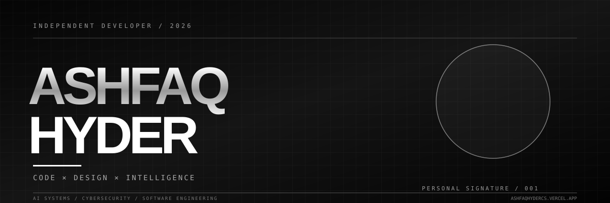

 

 

 

---

## `01 / ABOUT ME`

I'm **Ashfaq Hyder**, a Computer Applications postgraduate passionate about developing intelligent, secure, and meaningful digital experiences.

Currently pursuing MCA at **Presidency College**, with interests spanning software engineering, artificial intelligence, cybersecurity, and emerging technologies.

- 🎓 MCA Student (2025–2027)
- 💻 Software Development
- 🧠 Artificial Intelligence & Machine Learning
- 🛡️ Cybersecurity & Ethical Hacking
- 🔗 Blockchain Technology
- 🔬 Technical Research

 

> Building ideas into intelligent systems.

## `02 / TECHNOLOGY ARSENAL`

**PROGRAMMING**

**FRONTEND & BACKEND**

**DATABASES & DEVELOPMENT TOOLS**

**Exploring:** AI · ML · NLP · OWASP · CVSS · Web Security · Blockchain

## `03 / FEATURED PROJECTS`

### ◈ VALORYNN

**Web Application Security Assessment Platform**

A GUI-based security assessment platform featuring bounded scanning, vulnerability identification, severity scoring, remediation recommendations, and report generation.

`Python` `FastAPI` `Machine Learning` `OWASP` `CVSS`

[VIEW REPOSITORY →](https://github.com/ashfaqhyder/Valorynn)

---

### ◈ AI ASSISTANT

**Intelligent Conversational Application**

An AI-powered application using Flask and Gemini API with question answering, summarization, and creative response capabilities.

`Python` `Flask` `Gemini API` `Tailwind CSS`

[VIEW REPOSITORY →](https://github.com/ashfaqhyder/AI-Assistant-)

---

### ◈ ALGOTRUST

**Decentralized Credential Verification**

A blockchain-based credential verification project exploring decentralized verification and certificate authenticity.

`Algorand` `AlgoKit` `Blockchain`

[VIEW PROFILE →](https://github.com/ashfaqhyder)

---

### ◈ SMART CANTEEN

**Digital Canteen Management**

A canteen management application featuring Firebase integration and administrative dashboards.

`JavaScript` `Firebase`

[VIEW REPOSITORY →](https://github.com/ashfaqhyder/canteen-management)

## `04 / GITHUB ANALYTICS`

 

 

## `05 / EXPERIENCE & RESEARCH`

**VaultofCodes — AI & Prompt Engineering Intern**

Developed an AI assistant using Flask and Gemini API, gaining practical experience in prompt engineering and web application development.

**HOPE Foundation — Intern**

Participated in an AI-focused internship and worked on the Valorynn project.

**Research**

Presented a hybrid cyberbullying detection framework integrating CNN–LSTM with Attention, anomaly detection, and time-series analysis.

## `06 / CERTIFICATIONS & ACHIEVEMENTS`

- Ethical Hacking Certification
- Google Foundations of Cybersecurity
- IBM Artificial Intelligence Essentials
- Technical hackathon participation
- Research paper presentation

## `07 / CONNECT`

**Have an interesting idea or project? Let's connect.**

  

**CODE × DESIGN × INTELLIGENCE**

Building the future, one experiment at a time.

